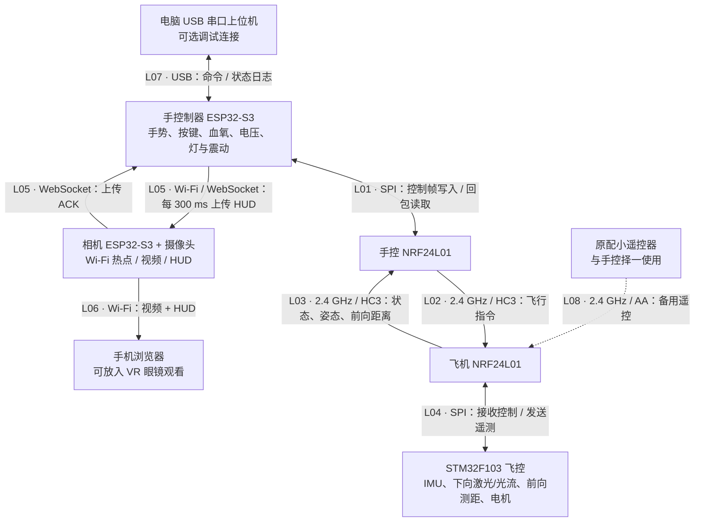
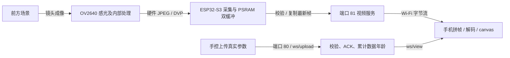
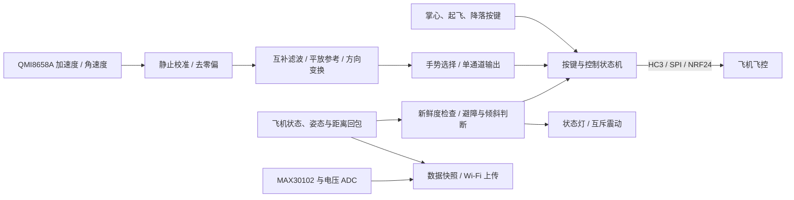
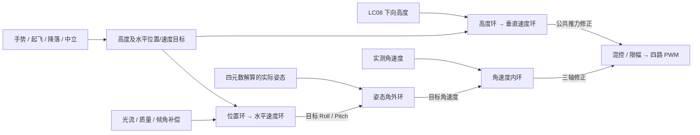

# 小飞机（Sight Beyond Steps）

手套手控 + 官方小飞机飞控 + 前视相机的联调工程。用手势和实体按键控制飞机，用前向测距做前方遇障保持，用手控灯和震动给出状态反馈，并在相机热点网页上叠加血氧、电压、姿态和测距。

当前主线以**官方 STM32 飞控**（含下向激光定高、光流定点、前向 UART3 测距）和 **ESP32-S3 手控制器** 为准。原配 AA 协议小遥控器仍可单独使用，不要与手控同时发射。

本文件集中说明当前工程的需求、物理连接、控制流程、精确阈值、通信协议、构建部署、测试证据和版本回退。根目录各专项 TXT 保留对应版本的原始记录，便于追溯；涉及现行行为时，以当前源码和下文的版本说明为准。文中的历史测试结果均注明适用版本，不代表本次重新执行，也不自动证明设备已烧录当前代码。

## 阅读导航与版本范围

- [系统组成](#系统组成)、[物理模块连接关系与指向标签](#物理模块连接关系与指向标签)
- [摄像机原理与说明](#摄像机原理与说明)、[手部控制器原理与说明](#手部控制器原理与说明)、[无人机姿态解算与避障原理](#无人机姿态解算与避障原理)
- [需求与实现对应](#需求与实现对应)、[当前飞行逻辑](#当前飞行逻辑)、[校准与手势参数](#校准与手势参数)
- [起飞、保持、降落与保护细则](#起飞保持降落与保护细则)、[避障、倾斜与指示](#避障倾斜与指示)
- [通信协议与诊断](#通信协议与诊断)、[相机、血氧与电压显示](#相机血氧与电压显示)
- [目录](#目录)、[操作要点](#操作要点)、[编译与部署](#编译与部署)
- [测试记录与验收](#测试记录与验收)、[版本标签与回退](#版本标签与回退)、[故障定位](#故障定位)
- [安全与已知限制](#安全与已知限制)、[原始专项文档索引](#原始专项文档索引)

当前源码已包含手控本地避障、地面报警、3 秒启动校准、10 秒冷却、光流恢复、650 起飞控制量上限、光流诊断、掌心点停修正、自动一米起飞及 GPIO11 缓降。最后一项功能对应 `3f2b565` / `build/slow-landing-20261007`。这些功能按时间叠加，不能把某一份早期专项说明当作整个当前版本的状态。

| 历史表述 | 当前解释 |
| --- | --- |
| 飞控判断避障、发送解除命令 6；倾斜 30°/25° | 双端反馈实验方案已被手控本地策略替代；当前倾斜为 20°/15°，解除由手控本地完成，无新增避障解除无线命令 |
| 飞控一直完全不改 | 仅描述 hand-only 那一次改动；后续已加入光流恢复、起飞、点停、诊断和缓降修正 |
| 相对升高 20 cm 后结束自动起飞 | 20 cm 是进入闭环爬升的门槛；当前继续升至向下测距约 1000 mm，并完成到高确认才进入 HOLD |
| GPIO11 单键立即停桨 | 当前飞行时单键缓降；GPIO9 + GPIO11 组合才立即停桨；显式 STOP 仍为锁定操作 |
| 手控应用分区 1 MiB、仅余数百字节 | 当前 `手控制器/partitions.csv` 为 2 MiB 应用分区，起始地址仍是 `0x10000` |
| 相机使用 GC2145 软件 JPEG | 当前 `camera_server.c` 使用 OV2640 硬件 JPEG；相机烧录子文档的 GC2145 和旧 Linux 路径属于历史记录 |

## 系统组成

| 端 | 硬件 | 源码目录 | 作用 |
| --- | --- | --- | --- |
| 手控制器 | ESP32-S3、QMI8658A、NRF24L01、MAX30102、五路状态灯、两路震动电机 | `手控制器/` | 手势识别、HC3 遥控、避障/倾斜本地策略、血氧与电压上传 |
| 飞控 | STM32F103、下向激光、光流、前向测距 UART3 | `官方小飞机的程序/主控程序(keil MDK打开)+外扩激光+光流20261001/` | 姿态、定高、光流定点、起飞/降落、失联保护 |
| 相机 | ESP32-S3、OV2640/GC2145、8MB Flash + 8MB Octal PSRAM | `相机/` | 无密码热点、双眼监控页、接收手控 HUD 参数 |
| 共享协议 | — | `shared/` | HC3 无线帧、HUD WebSocket 协议、震动排程 |
| 资料与原厂程序 | — | `无人机资料/` | 原理图、原遥控/飞控参考，不作为当前部署入口 |

无线：NRF24 频道 1、1 Mbps、地址 `E1 E2 E3 E4 E5`、32 字节、硬件 CRC16、无自动 ACK。手控与飞机使用 HC3；原遥控器使用 AA 协议，频道和地址相同。

相机：开机建立热点 `Camera-D6A4`（后缀随 MAC），无密码。手机连上后打开 `http://192.168.4.1/`。手控每 300 ms 向 `ws://192.168.4.1/ws/upload` 上传显示数据，不经过该链路发飞行命令。

## 物理模块连接关系与指向标签

### 整机连接总览

箭头表示数据、控制信号或反馈的方向，不表示供电方向；`↔` 表示双向通信。图中 `Lxx` 对应下方链路表，板内连接使用 `Hxx`（手控）、`Fxx`（飞控）、`Cxx`（相机）标签。所有 GPIO 均为所属主控的 GPIO 编号；手控和相机是两块不同的 ESP32-S3，不能按相同 GPIO 编号互接。



| 标签 | 起点 → 终点 | 接口 / 协议 | 传递内容与用途 |
| --- | --- | --- | --- |
| L01 | 手控 ESP32-S3 ↔ 手控 NRF24L01 | SPI2，mode 0，500 kHz；另有 CE、可选 IRQ | 写入 HC3 控制帧，读取飞机回包；具体接线见 H04 |
| L02 | 手控 NRF24L01 → 飞机 NRF24L01 | 频道 1（2401 MHz）、1 Mbps、32 字节、CRC16 | 锁定、解锁、起飞、降落及 Roll/Pitch/升降/Yaw 指令 |
| L03 | 飞机 NRF24L01 → 手控 NRF24L01 | 与 L02 相同的无线参数；HC3 回复时隙 | 操作确认、锁定/飞行状态、飞机姿态、前向距离及有效性；供手控反馈和 HUD 使用 |
| L04 | 飞机 NRF24L01 ↔ STM32F103 | 软件 SPI；另有 CE、IRQ | 飞控读取无线命令，写入状态/遥测回复；具体接线见 F01 |
| L05 | 手控 → 相机；相机 → 手控 | 手控作为 Wi-Fi STA 接入相机 AP；端口 80，`/ws/upload` | 正向每 300 ms 上传血氧、手控电压、飞机姿态和前向距离；反向返回应用层 ACK，用于确认上传及驱动相机通信指示灯 |
| L06 | 相机 → 手机浏览器 | 手机同样接入相机 AP；网页端口 80，视频端口 81 | `/` 提供页面，`/ws/view` 推送 HUD，`:81/stream?size=qvga&quality=fast&format=bytes` 提供视频；浏览器发起请求并接收显示数据 |
| L07 | 电脑 ↔ 手控 ESP32-S3 | USB Serial/JTAG 串口 | 电脑下发上位机命令、配置和诊断请求；手控返回状态与日志。实体按键控制可独立运行 |
| L08 | 原配小遥控器 → 飞机 NRF24L01 | AA 协议；频道、地址与手控相同 | 备用控制入口；切换前停止手控发送并等待约 0.6 s，避免两个发送端同时占用 |

L02/L03 的无线地址按 SPI 写入顺序为 `E1 E2 E3 E4 E5`，硬件自动 ACK 关闭；L03 是固件主动发送的回复，不是 NRF24 自动 ACK。L05 的 ACK 则属于 WebSocket 应用协议，两者独立。

### 手控制器内部连接（H01～H08）

| 标签 | 模块 / 信号方向 | 引脚或接口 | 作用与连接说明 |
| --- | --- | --- | --- |
| H01 | 手控 ↔ QMI8658A；测量数据由 IMU → 手控 | I²C0：GPIO41 ↔ SDA，GPIO42 → SCL；7 位地址 `0x6B` | 读取手部加速度和角速度，计算手势；SA0 接 GND。该姿态用于操控，HUD 中的飞机姿态来自 L03 |
| H02 | 手控 ↔ MAX30102 血氧模块 | I²C1：GPIO39 ↔ SDA，GPIO38 → SCL；7 位地址 `0x57` | H2：pin 1=3V3、2=SCL、3=SDA、4=INT、5=GND。INT → GPIO40 为预留连接，当前读取 FIFO 不依赖中断线；模块供电需支持 3.3 V |
| H03 | 掌心 / 起飞 / 缓降按键 → 手控 | H5 pin 2 → GPIO9；pin 4 → GPIO10；pin 6 → GPIO11 | 当前代码均按低电平按下判定。GPIO9 为掌心保持，GPIO10 按下后松开触发起飞流程，GPIO11 请求缓降；GPIO9 + GPIO11 为组合急停 |
| H04 | 手控 ↔ NRF24L01 | GPIO6 → SCK；GPIO7 → MOSI；MISO → GPIO8；GPIO16 → CSN；GPIO4 → CE；IRQ → GPIO2（可选） | VCC 接 3V3，GND 接手控 GND；轮询收包，不要求连接 IRQ。GPIO15 已用于电压采样，不能代替 CSN 的 GPIO16 |
| H05 | 手控 → 五路状态灯 | GPIO12 / 13 / 14 / 21 / 47 | 依次为飞控通信、相机上传、左倾、右倾、下降；低电平点亮，实物位置以逐灯核对为准 |
| H06 | 手控 → 前向避障报警灯 | GPIO5 → H6（LED7） | 低电平点亮；地面近距离常亮，飞行避障保持时闪烁，具体触发条件见下文 |
| H07 | 手控 → 板上驱动电路 → 两路震动电机 | GPIO18 → MOT0（H3）；GPIO17 → MOT1（H4） | PWM 经驱动电路开关电机电源，GPIO 不直接给电机供电；MOT0 提示近障/保持，MOT1 提示飞机倾斜，两路互斥且倾斜优先 |
| H08 | 手控 VCC_IN → 分压电路 → ADC | R7/R10 各 10 kΩ 分压，中点经 R9（499 Ω）→ GPIO15 / ADC2_CH4 | 测量输入电压并应用现有单点比例校准后经 L05 上传；此采样网名为 VCC_IN，不能直接当作电池接口 VBAT_IN |

### 飞机内部连接（F01～F05）

| 标签 | 模块 / 信号方向 | 引脚或接口 | 作用与连接说明 |
| --- | --- | --- | --- |
| F01 | STM32F103 ↔ 飞机 NRF24L01 | PB13 → SCK；PB15 → MOSI；MISO → PB14；PB12 → CSN；PB8 → CE；IRQ → PA8 | 对应 L04。以当前代码宏和端口初始化为准，原文件部分旧注释中的 CE/IRQ 引脚文字与实际代码不一致 |
| F02 | STM32F103 ↔ MPU6050；测量数据由 IMU → 飞控 | 软件 I²C：PB6 → SCL，PB7 ↔ SDA；7 位地址 `0x68`（代码写地址字节 `0xD0`） | 提供机体加速度、角速度及姿态解算输入，供姿态控制和 L03 遥测使用 |
| F03 | STM32F103 ↔ LC08 下向激光/光流模块；高度/光流 → 飞控 | 与 F02 共用 PB6/PB7 的 I²C 总线；7 位地址 `0x62`（代码写地址字节 `0xC4`），从寄存器 `0x33` 读取 | 返回下向高度、X/Y 光流量与质量，供定高/定点使用。当前固件通过 LC08 接口取得这两类数据，并未把激光和光流分别接到两路 UART |
| F04 | 前向测距模块 TX → STM32F103 RX | 模块 TX → PB11 / USART3_RX；9600 baud，8N1；有线连接须共地 | 帧格式 `5A 5A 45 02 high low sum8`，距离单位 cm。当前仅配置接收，不要求从 PB10 发命令；前向距离经 L03 回传给手控，与 F03 下向高度区分 |
| F05 | STM32F103 → 电机驱动 / 四路机载指示灯 | 电机：PA0～PA3 / TIM2 CH1～CH4；指示灯：PA6、PA7、PB0、PB1 / TIM3 CH1～CH4 | 电机 PWM 经板上驱动电路控制四路动力，灯用于连接/锁定状态提示；此处通道编号不推定电机在机架上的前后左右位置 |

### 相机内部连接（C01～C03）

| 标签 | 模块 / 信号方向 | 相机 ESP32-S3 引脚 | 作用与连接说明 |
| --- | --- | --- | --- |
| C01 | 相机主控 ↔ 摄像头配置接口 | GPIO4 ↔ SCCB SDA；GPIO5 → SCCB SCL | 识别并配置摄像头寄存器；当前固件使用 OV2640 的硬件 JPEG 输出，GC2145 是历史适配方案 |
| C02 | 相机主控 → 摄像头；摄像头 → 相机主控 | GPIO15 → XCLK；PCLK → GPIO13；VSYNC → GPIO6；HREF → GPIO7 | 提供摄像头主时钟并接收像素时钟、帧/行同步；RESET、PWDN 在配置中均为 `-1`，未作为 MCU 控制脚使用 |
| C03 | 摄像头 D0～D7 → 相机主控 | D0→GPIO11，D1→GPIO9，D2→GPIO8，D3→GPIO10，D4→GPIO12，D5→GPIO18，D6→GPIO17，D7→GPIO16 | DVP 八位并行图像数据，对应传感器 DVP_Y2～Y9；采集后经 L06 发往手机 |

手机与手控都连接相机热点，默认同时容纳这两个客户端；视频只允许一个观看连接。VR 眼镜承载手机观看，双眼显示复制同一摄像头画面。当前代码没有相机主控与 STM32 飞控之间的直接数据接口，飞机遥测通过“飞控 → 手控 → 相机 → 手机”转发。

### 完整信号路径与供电边界

- **操控路径：** H01 手部 IMU / H03 按键 → 手控 → L01 → L02 → L04 → 飞控 → F05 电机驱动。
- **避障与倾斜反馈：** F04 前向距离 / F02 机体姿态 → 飞控 → L04 → L03 → L01 → 手控本地判断 → H05/H06 状态灯及 H07 震动电机；需要保持时由手控经 L02 发回中立通道指令。
- **定高与定点：** F03 下向高度/光流 → 飞控控制算法 → F05 电机驱动，在飞机侧闭环运行。
- **画面与参数：** C03 图像 → 相机 → L06 手机；H02 血氧、H08 电压以及 L03 飞机遥测 → 手控 → L05 相机 → L06 手机。

上述图表描述信号连接，不替代供电原理图。同一板上的有线外设须接对应电源与 GND；无线连接本身不要求手控、飞机和相机之间另接共地线。仓库现有说明未确认相机与飞机是否共用电池、各外接测距模块的实物供电接口，因此这里不指定跨板供电接法。震动电机通过板上驱动级供电，手控子文档记录的图纸选配电压为 1.8 V，实装以对应板卡为准。

连接依据为当前固件与仓库硬件说明：手控的 [主程序](手控制器/main/main.c)、[默认 SPI 配置](手控制器/sdkconfig.defaults)、[按键与灯](手控制器/main/led_demo.c)、[血氧](手控制器/main/max30102_demo.c)、[震动驱动](手控制器/main/vibration.c)、[电压采样](手控制器/main/input_voltage.c)；飞控目录的 `CONFIG/Spi.c`、`CONFIG/I2C.h`、`CONFIG/TIM.c`、`HARDWARE/nrf24l01.c`、`HARDWARE/mpu6050.c`、`HARDWARE/flow.c`、`HARDWARE/obstacle.c`；相机的 [引脚映射](相机/main/board.h)。这些是代码配置与文档记录，不代表每条实物连线都已重新测量验证。

## 摄像机原理与说明

### 1. 职责与数据流程

摄像机承担前方画面采集、热点建网、视频传输和 HUD 参数显示。当前代码不从图像识别障碍、不从图像估算距离，也不直接给飞控发控制指令。网页显示的距离来自飞机上的独立前向测距模块，经手控上传；Pitch/Roll 是飞机姿态，血氧和输入电压来自手控。



### 2. 图像采集与接口工作原理

镜头把场景投射到 OV2640 感光面，传感器内部完成图像处理和 JPEG 压缩，ESP32-S3 接收压缩帧。主控通过 SCCB 读写传感器寄存器，设置分辨率、JPEG 质量等；图像经独立的 DVP 接口传输。能通过 SCCB 读出 PID，只证明配置通路可用，不能证明 DVP 图像完整。

| 信号 / 标签 | 在采集过程中的作用 |
| --- | --- |
| SCCB SDA/SCL / C01 | 配置和查询传感器寄存器，不承载视频帧 |
| XCLK / C02 | ESP32-S3 向传感器提供 20 MHz 主时钟 |
| PCLK / C02 | 传感器给出并行数据采样节奏 |
| VSYNC、HREF / C02 | 提供帧和行相关同步时序 |
| D0～D7 / C03 | 八位并行数据，JPEG 模式下最终组成压缩图像字节 |

当前初始化明确检查 OV2640 PID，其他传感器会报不支持。历史 GC2145 路径是 RGB565 采集后由 ESP32 软件编码 JPEG，不能只换传感器而假定当前固件继续兼容。引脚见前文 C01～C03。

### 3. 缓冲、帧校验与网络发送

驱动在 PSRAM 使用两个帧缓冲，`CAMERA_GRAB_LATEST` 优先取得较新的画面。服务取帧后检查 JPEG 格式、长度、SOI/EOI 标记以及到 SOS 为止的头段边界；合法帧复制到复用发送缓冲后立即归还采集帧，再进行网络发送。这样避免网络发送长期占住刚取得的采集帧，但网络拥塞仍会影响延迟和帧率。

当前帧长度上限为 160 KiB。启动先丢弃两帧，再检查最多三帧真实输出；全部失败会停用采集并报告 `ESP_ERR_INVALID_RESPONSE`，网页和 HUD 服务仍可启动。头段检查不代替完整像素解码，浏览器可能继续发现图像损坏。

端口 81 的 `/stream` 连续发送帧边界、`Content-Length` 和 JPEG 内容。默认网页加 `format=bytes`，HTTP 类型为 `application/octet-stream`，自行解析网络分片和帧长度；不带参数时保留 multipart 类型。TCP 一次读取不等于一张图片，因此浏览器需要缓存并拼接完整帧，不能把每个收到的片段直接当成 JPEG。

### 4. 手机解码、双眼显示与 HUD

网页先用 `createImageBitmap` 解码，失败时可回退到 Image 路径，成功后绘制到 canvas。双眼模式把同一解码结果画到左右区域，没有第二条视频流或双目景深。HUD 通过独立 WebSocket 更新，按源数据年龄决定显示值或 `--`；视频停顿不应把旧参数继续标成实时。

手控上传带 `session/seq`，相机校验后返回 ACK，再向观看者推送。源年龄在相机缓存和浏览器显示期间继续增加，重发同一数据不会刷新其测量时间。网页和视频分别在 80/81 端口，因而“参数正常、画面损坏”是可能出现的两条独立链路状态。

设备发送 fps、手机显示 fps、采集时间和网络延迟应分别记录。`encode_ms=0` 表示 ESP32 不做软件 JPEG 编码，不表示传感器压缩没有耗时。分辨率/质量提高会增加帧大小和带宽需求；实际验收要看连续可解码画面、延迟、切换恢复和 HUD 过期行为，而不只看网页能否打开。

| 现象 | 首先核对 |
| --- | --- |
| 找不到热点 | 相机供电、AP 初始化、启动日志和实际热点后缀 |
| 连到热点但页面打不开 | 手机是否仍连接相机 AP、`192.168.4.1` 和端口 80 服务 |
| 参数正常而视频不可用 | 传感器初始化、排线/DVP、真实 JPEG 校验、端口 81 |
| 识别到 OV2640 但解码失败 | 实际帧头/长度/尾标记、排线与模块；PID 成功不排除数据线问题 |
| 画面正常但 HUD 为 `--` | 上传 ACK、源有效位/年龄，飞机字段还需核对 NRF 回包 |
| 第二个观看页面返回 503 | 是否已有观看连接，或相机初始化失败导致服务不可用 |

实现入口：[camera_server.c](相机/main/camera_server.c)、[hud_server.c](相机/main/hud_server.c)、[board.h](相机/main/board.h)。

## 手部控制器原理与说明

### 1. 从手部动作到无线控制



QMI8658A 测量手部，飞机 MPU6050 测量机体，分别用于操控输入和飞行稳定。手控发送通道值和显式命令，不直接计算每个推进电机的 PWM；飞机姿态变化也不能用手部角度代替。

### 2. 采样、零偏与互补滤波

主程序配置加速度 ±4 g、陀螺仪 ±512°/s，并按 QMI8658A 寄存器定义修正组件配置，角速度按 64 LSB/(°/s) 换算。主循环检查数据就绪，约每 10 ms 轮询一次；实际积分时间取有效样本时间戳差，单次 dt 上限为 0.05 s。

启动静止窗口计算各轴角速度均值作为 bias，之后使用 `gyro_corrected = gyro_raw − bias`。同一窗口的加速度均值用于首次姿态和平放参考；3 s/200 样本等全部条件见下文校准参数，未完成校准不输出可起飞姿态。

当前互补滤波关系如下；加速度角度计算结果先由弧度转为度，角速度单位为 °/s：

```text
roll_acc  = atan2(ay, az) × 180/pi
pitch_acc = atan2(-ax, sqrt(ay² + az²)) × 180/pi
roll_pred  = roll_prev  + gyroX_corrected × dt
pitch_pred = pitch_prev + gyroY_corrected × dt
roll  = roll_pred  + 0.02 × wrap_to_180(roll_acc - roll_pred)
pitch = pitch_pred + 0.02 × (pitch_acc - pitch_pred)
```

陀螺仪积分负责短时间动作连续性，加速度的重力参考每次以 2% 修正量约束漂移。它是手控的俯仰/横滚估计，不是完整三维惯导，也没有用手部 Yaw 作为绝对航向。快速平移时加速度含有运动分量，可能扰动估计，因此需要实际佩戴与动作测试。

### 3. 手势、按键和保护如何组合

姿态先扣除平放零点，再做默认轴交换和反向。进入/退出角度回差让手势不会在阈值附近频繁切换，主轴优势门限使模糊斜向不同时产生两个方向。掌心优先中立，起飞使用新的按下/松开边沿，降落锁存，组合急停覆盖普通动作。

`hand_control` 任务每 50 ms 更新手势、实体按键与心跳，优先级 5；日志单独运行，相机上传任务优先级 2。无线发送前还会根据飞行阶段、本地避障锁存和数据失效状态覆盖运动通道，所以界面手势识别结果不一定等于最终控制包。相机上传等待上一包 ACK 后才发送下一包，超时关闭重连，不堆积离线数据再突发补发。

接收端先验证 CRC、版本、会话和序号，再分别维护普通确认、姿态/测距遥测及诊断缓存。普通状态帧不能刷新传感器样本时间，诊断页也不算控制确认。发送了急停包不代表飞机已经收到并停桨，还要结合锁定回包或飞控失联保护判定。

### 4. 血氧、电压和反馈原理

MAX30102 提供红光/红外 PPG，软件读取 FIFO 并调用现有健康算法组件滚动计算血氧；接触情况、原始信号、结果有效性和年龄分别保存。GPIO15 通过分压测 VCC_IN，经单点比例校准后上传。两者只用于显示，不参与推进动力闭环，也不测量飞机电池电量。

状态灯由低电平点亮，震动 PWM 经板上驱动级控制电机供电。MOT0 对应近障，MOT1 对应飞机倾斜；事件锁存避免同一持续输入无限延长脉冲，互斥调度使倾斜优先，再补足暂停的避障余时。软件输出日志只能证明发出了指令，灯的实物位置和震动触感仍要台架确认。

实现入口：[main.c](手控制器/main/main.c)、[gesture.c](手控制器/main/gesture.c)、[telemetry.c](手控制器/main/telemetry.c)、[tx_control.c](手控制器/main/tx_control.c)。

## 无人机姿态解算与避障原理

### 1. 调度周期与输入数据

| 名义周期 | 执行内容 | 说明 |
| --- | --- | --- |
| 3 ms | 串口测距解析、MPU 读取、HC3 保护/命令、姿态控制、电机混控、输出观察 | 约 333 Hz 基础节拍 |
| 6 ms | 姿态解算、高度控制、LC08 高度/光流读取 | 约 167 Hz；代码给 `GetAngle` 的 dt 为 0.00626 s，给高度环的 dt 为 0.006 s |
| 24 ms | 光流估计、水平位置/速度控制 | 约 41.7 Hz |

节拍来自 `USER/scheduler.c`。同一中断内，24 ms 分支在 3 ms 分支前，6 ms 分支在后，因此部分控制使用上一轮完成的估计；不能把各源描述为同时采得。代码统计中断耗时、最大耗时及达到 3000 µs 的超期次数，实际实时性还需硬件日志验证。

### 2. MPU6050 预处理

传感器配置为加速度 ±4 g、陀螺仪 ±2000°/s。`MpuGetData` 从 I²C 读取并合并高低字节，扣除 `MpuOffset`；加速度三轴分别进入一维 Kalman 滤波，角速度使用 `g_filtered = 0.85 × g_previous + 0.15 × g_sample` 的低通。读取失败不刷新有效 IMU 时间。

这是飞控自身的校准与滤波，和手控启动校准不同。飞控校准页需随设备保留，不能用另一块板偏置或模板填充区覆盖。

### 3. 四元数姿态融合过程

`MATH/imu.c` 的 `GetAngle` 保存单位四元数 q。先用 q 计算估计重力方向，再将加速度归一化并与估计重力做叉乘，获得方向偏差。用偏差的比例与累积项修正陀螺仪，积分更新 q 后归一化，最后转换出俯仰和横滚。

```text
q = [q0, q1, q2, q3]
g_est = [2(q1q3-q0q2), 2(q0q1+q2q3), 1-2(q1²+q2²)]
a_norm = a / |a|
e = a_norm × g_est
bias_correction += 0.0003 × e
omega_corrected = gyro_filtered × Gyro_Gr + 0.5 × e + bias_correction
q_next = normalize(q + 0.5 × (q ⊗ [0, omega_corrected]) × dt)
Pitch = -asin(g_est_updated.x) × 180/pi
Roll  = atan2(g_est_updated.y, g_est_updated.z) × 180/pi
```

`g_est_updated` 表示更新 q 后重新计算的方向，`⊗` 为四元数乘法。代码误差累积每次直接加 `0.0003×e`，不再乘 dt，系数与更新节拍有关，不能直接当作任意采样率下相同的连续时间积分增益。`Gyro_Gr=0.0005326×2` 将滤波后的原始陀螺仪量换为 rad/s。

重力参考主要约束 Pitch/Roll。当前没有接入磁力计或绝对航向源；`YAW_GYRO` 宏未启用时，Yaw 走 Z 轴角速度积分，仅 `|yaw_rate|>0.8°/s` 才累加，解锁准备时归零。代码也保留从四元数提取 Yaw 的编译分支，但都不能据此宣称有罗盘绝对航向。运动加速度、振动和偏置会影响估计结果。

### 4. 姿态、高度、光流如何闭环控制



姿态角外环把角度误差变成目标角速度，角速度内环用陀螺仪反馈产生修正量。普通 PID 用比例、误差积分和误差差分三项；水平保持环另有下文详述的积分保护、停止边沿捕获和比例增强，不能把所有环的限幅策略混为一谈。

高度估计将姿态投影后的垂直加速度与下向测距变化融合：代码把高度跟随的单次跳变限于 50，以 0.985/0.015 权重融合惯性速度预测与测高差分。高度外环输出垂直速度请求，速度内环修正公共推力。光流返回 dx/dy、质量和高度，飞控仅累计有效位移，经过倾角补偿、滤波及位置/速度环生成目标倾角；这是局部反馈，不是 GPS 或地图定位。

定高时公共量为 `thr_hold + pidHeightRate.out`，手动映射为 `200 + 0.45×(Remote.thr−1000)`。设公共量为 T、三个角速度环输出为 X/Y/Z，混控为：

```text
M1 = T + X + Y + Z
M2 = T + X - Y - Z
M3 = T - X + Y - Z
M4 = T - X - Y + Z
```

公共量先限 0～800，最终电机输出限 0～1000，锁定/急停清零。M1～M4 是软件通道，实物位置、旋转方向及桨方向须按板卡核对。保持成功还取决于有效传感器、控制裕量、安装与动力条件，不能仅凭通道中立判断。

### 5. 前向测距到避障保持的六个步骤

1. **接收数据：** 前向模块 TX 接 PB11，USART3 使用 9600、8N1，DMA 128 字节循环缓冲；3 ms 分支取待解析字节。
2. **解析校验：** 七字节滑动窗口寻找 `5A 5A 45 02 high low sum8`，前六字节和的低八位须匹配校验；按高低字节合成 cm，20～720 cm 才有效。噪声或丢字节后继续滑动找帧头。
3. **回传遥测：** 飞控保存源更新时间，超过 600 ms 返回未知；约每 300 ms 用 `HC_TELEMETRY` 回传前向距离和机体姿态。
4. **手控决策：** 校验新回包后，飞行遇到有效距离 `≤100 cm` 锁存保持；地面仅提示，起飞保留自动爬升，正常降落优先。
5. **闭环执行：** 正常定高飞行时手控发四通道 1500，飞机依靠已有高度/光流闭环尝试保持；GPIO5 闪烁，MOT0 震动。中立不直接关闭电机，也不瞬间把速度变零。
6. **条件解除：** 距离严格 `>120 cm` 的新有效遥测覆盖至少 500 ms 后，再新按掌心解除本地锁存；按住仍中立，松开重新识别手势。没有自动绕行或自动恢复前进。

100/120 cm 回差抑制距离阈值抖动，连续确认避免单帧远距离误放行。实际停止距离还受初速度、测距盲区、无线延迟、惯性、光流地面条件和动力余量影响。当前只有一只前向模块，没有后/左/右独立测距，摄像机也未参与障碍识别，因此不能宣称全向避障。飞机倾斜 >20° 的手控灯/震动只提示机体状态，不是额外测距。

实现依据：飞控 `HARDWARE/mpu6050.c`、`MATH/imu.c`、`MATH/myMath.c`、`HAL/control.c`、`HARDWARE/flow.c`、`HARDWARE/obstacle.c`、`USER/scheduler.c`，以及手控 `main/hand_feedback.h`、`main/tx_control.c`。

## 需求与实现对应

| 编号 | 需求与验收要点 | 当前实现入口 |
| --- | --- | --- |
| R01 | 静止校准后只自动建立锁定连接，必须新操作起飞键才启动 | 手控 `gyro_calibration.c`、`flight_keys.c`、`tx_control.c` |
| R02 | 手势单方向输出；掌心按住四通道中立；平放连续 1 s 后前进 | 手控 `gesture.c`、`control_output.c`、`telemetry.c` |
| R03 | 起飞控制量按原斜率增加，有离地证据才放宽至 650，再闭环升至约 1 m | 飞控 `HAL/hand_link.c`、`HAL/control.c` |
| R04 | 近障锁存保持；有效远距离稳定后，新按掌心才解除 | 手控 `hand_feedback.h`、`tx_control.c`；不修改飞控协议来解除 |
| R05 | 地面近障灯常亮、一次震动；倾斜在地面及飞行时均提示 | 手控 `hand_feedback.h`、`hand_indicator.h`、`led_demo.c` |
| R06 | 两路报警震动互斥、倾斜优先，每次事件不因重复采样而无限延长 | `shared/haptic_policy.h`、手控 `vibration.c` |
| R07 | GPIO11 锁存缓降，组合键立即停桨；结束后保持通信及 10 s 冷却 | 手控 `flight_keys.c`、`tx_control.c`；飞控 `hand_link.c` |
| R08 | 光流无效时不沿用旧坐标目标，恢复后重建目标；点停时双轴捕获当前位置 | 飞控 `HARDWARE/flow.c`、`HAL/control.c` |
| R09 | 诊断只读，不能替代控制确认或触发动作；丢页、旧页不能假装完整 | `shared/flow_diagnostics.h`、飞控 `flow_diagnostics_tx.h`、手控 `flow_diag_log.h` |
| R10 | 视频与 HUD 独立更新，真实无效值显示 `--`；不通过网页发飞行控制 | 相机 `camera_server.c`、`hud_server.c`，手控 `camera_uplink.c` |
| R11 | 构建、烧录与实机验收分别留证；回退保留用户改动和实机校准 | `tools/`、飞控 `port/`、`verification/` 及发布清单 |

上述文件名分别位于前文列出的工程目录。验收须同时看输入、状态、输出及源数据新鲜度，不能仅凭灯亮、串口在线或编译成功认定闭环功能完成。

## 当前飞行逻辑

1. 手控上电后平放静止完成陀螺仪校准（连续静止约 3 s，各轴角速度波动不超过 5°/s，且仍须收齐有效样本）。校准完成且 NRF24 就绪后自动连接飞机，只发锁定包。
2. 平放后按下并松开 **GPIO10（起飞）**：解锁确认 → 缓升起飞。相对地面升高至少 20 cm 并确认后接入定高/光流闭环，继续平滑增加高度目标至向下测距 1000 mm；实测到高并稳定后进入 HOLD。
3. **GPIO9（掌心）** 按住：四通道中立。定高有效时用于点停/保持，不是关电机。松开后恢复当前手势；平放满 1 s 才前进。
4. **GPIO11**：飞行中按下进入自动缓降（约 15 cm/s，约 20 cm 内停桨）。地面或未起飞时仍取消启动并保持锁定。
5. **GPIO9 + GPIO11 同时按下**：立即 DISARM 停桨。缓降前必须先松开掌心键，否则会走组合急停。
6. 急停或落地后继续发送锁定，并有约 10 s 再起飞冷却；冷却结束仍须重新按 GPIO10，不会自动起飞。
7. 飞控超过 600 ms 收不到有效控制会锁定并清零四路 PWM。高度闭环丢失时走手动推力回退；仅水平光流估计失效时暂停位置纠偏并重建目标，不把它直接等同于高度失效。

手势默认相对安装方向做了轴交换和反向（逻辑 Pitch / Roll）。同一时刻只有一个方向通道有效。左右倾斜默认走偏航；抬手上升、下垂下降。

### 手控与飞控状态对照

| 场景 | 手控状态 | 飞控阶段 / 含义 |
| --- | --- | --- |
| 尚未连接或故障 | `TX_OFF=0`、`TX_FAULT=10` | 不能根据本地状态推断飞机已停桨，需看回包及失联保护 |
| 已连接、持续锁定 | `TX_READY=1` | `LOCKED=0`；只发锁定包 |
| 请求解锁 / 已解锁待起飞 | `TX_ARM_REQUEST=11`、`TX_ALT_IDLE=12` | `IDLE=1`；尚不是正常飞行保持 |
| 自动起飞 | `TX_ALT_TAKEOFF=13` | `TAKEOFF=2`；包括初段推力爬升和后段一米闭环爬升 |
| 正常定高控制 | `TX_ALT_LIVE=14` | `HOLD=3`；手势、掌心和本地避障中立策略在此作用 |
| 自动降落 | `TX_ALT_LAND=15` | `LAND=4`；松开 GPIO11 不取消降落 |
| 高度失效 / 手动 / 请求恢复 | `TX_ALT_LOST=16`、`TX_ALT_MANUAL=17`、`TX_ALT_RESUME=18` | 协议保留 `HEIGHT_LOST=5`、`FAULT=6`、`MANUAL=7`；按实际回包判断，不据枚举存在推断必经阶段 |

手控状态号和飞控阶段号来自不同状态机，不能混用。无线普通回包确认、传感器遥测和诊断页也分别计时，收到诊断页不等于收到新的控制确认。

## 校准与手势参数

### 启动陀螺仪校准

| 判据 | 当前数值 / 行为 |
| --- | --- |
| 连续静止窗口 | 至少 3000 ms，且至少 200 个独立有效样本 |
| 每轴角速度窗口波动 | `max - min ≤ 5°/s`；5°/s 是角速度波动，不是姿态角变化 |
| 每轴原始角速度 | 绝对值 `≤ 5°/s` |
| 重力幅值 | 900～1100 mg |
| 每轴加速度窗口波动 | `≤ 30 mg` |
| 样本间隔 | 超过 250 ms 重新采样；重复时间戳不充当新样本 |
| 异常值 | 无效读取、NaN、Inf 不通过；晃动超限会重新积累窗口 |
| 完成后 | 本次启动只完成一次，不在飞行中重新学习陀螺仪偏置 |

校准成功后记录平放参考，再允许自动锁定连接。开机满 3 秒并不保证完成；传感器无效、样本不足或佩戴晃动都会延长等待。GPIO12 还需要飞机新鲜回包，GPIO13 还需要相机上传 ACK，因此校准完成不意味着两盏通信灯必然同时亮。

### 手势选择与输出

默认 `ginvp=1`、`ginvr=1`、`gswap=1`：逻辑 Pitch 为负的相对原始 Roll，逻辑 Roll 为负的相对原始 Pitch。这里使用扣除平放零点后的角度；飞机倾斜报警不应用这组手部方向变换。

| 参数 | 数值 / 含义 |
| --- | --- |
| 新方向进入角 | 主轴绝对值 `≥ 20°`，且比另一轴至少大 `10°` |
| 已选方向保持 | 该方向角度 `> 12°`，且比另一轴至少大 `5°` |
| 平放范围 | 两轴均在 `±10°` 内，连续 1000 ms 后才识别前进 |
| 模糊斜向 / 过渡状态 | 不新发斜向组合指令；四个运动通道中立 |
| 掌心优先 | 按住清除运动选择；松开后依据当前姿态重新识别 |

| 识别结果 | 手控发送的运动通道 | 飞控解释 |
| --- | --- | --- |
| 平放满 1 s | Pitch=1700 | 前进；光流模式在飞控侧映射到原方向阈值以外 |
| 左倾 / 右倾 | 默认 Yaw=1300 / 1700 | 左转 / 右转；可在停止发送时改选 Roll 通道 |
| 抬手 / 下垂 | 升降=1800 / 1100 | 定高正常时沿用原上升 +250 mm/s、手势下降 −350 mm/s 请求 |
| 掌心 / 未决过渡 | Roll、Pitch、升降、Yaw 均为 1500 | 中立；1500 不是 1500 mm 的目标高度 |

每次只有一个手势通道偏离 1500，辅助通道默认 `[2000,1000,1000,1000]`。飞控光流模式将 Roll/Pitch 方向输入转换为 1200/1800，偏航转换为 1100/1900。手势下降与 GPIO11 的 −150 mm/s 自动缓降是两条不同路径。

## 起飞、保持、降落与保护细则

### 起飞控制量与一米目标

1. 初始基础控制量为 245.5，斜率为 `(500−245.5)/2000 = 0.12725` 控制单位/ms，即 127.25/s。无可靠离地证据时上限为 500。
2. 绝对测高 `≥50 mm 且 <3500 mm`、相对地面 `≥50 mm`、读取有效且样本年龄 `≤100 ms`，才允许继续按相同斜率加至 650。理想连续条件下从起点加到 650 约需 3.18 s，但可以提前进入高度闭环。
3. 已超过 500 后若测高无效、过期或不满足离地条件，只冻结追加量，不突然退回 500；恢复后逐步继续。调度间隔 `>100 ms` 时本次步进按 0 处理，不追补累计时间。
4. 相对地面升高 `≥200 mm` 并持续确认 100 ms 后进入高度闭环，飞控阶段仍保持 TAKEOFF。定高基准沿用 HC3 起飞/手动阶段记录的 `thr_hold`，接受 205～650；无 HC3 所有权或基准异常时使用原默认 500。
5. 闭环高度目标从当前测量起步，最大上升速度请求 200 mm/s、速度变化率 150 mm/s²，最终目标为同一地板上的绝对向下距离 1000 mm；不再叠加上电时的地面偏移。
6. 目标到达 1000 mm、原始实测高度在 950～1050 mm 内、估计垂直速度绝对值 `≤100 mm/s`，连续 500 ms 才转 HOLD。爬升阶段保持水平中立，不放行普通手势打断自动轨迹。
7. 自动目标遇到短暂无效测高会暂停，恢复不跳变；高度闭环丢失则回退手动。起飞超过 15 s 未完成时记录 `HC_TAKEOFF_TIMEOUT=11`：若已闭环且高度有效，转当前高度保持；否则转原手动降级，不直接断油门。

650 是基础控制量上限，不代表实际升力必然提高 30%，也不是修改电机额定值。到达一米后的抬手可继续上升，回中再捕获当前高度，不强行拉回一米。起飞过程中的 LAND、DISARM、IMU 和失联保护仍优先。

### 掌心点停与光流恢复

掌心按住的作用是中立输入。高度有效时保持高度；水平位置保持还要求光流有效、控制环已进入运行状态。松手恢复手势，平放前进仍重新遵守 1 秒确认。

| 项目 | 当前规则 |
| --- | --- |
| 光流有效样本 | 质量 `>30`，高度 80～3499 mm，源年龄 `≤100 ms` |
| 短暂读取失败 | 100 ms 内可沿用上一份有效样本；超过窗口不再使用 |
| 坏样本 | 不累计水平位移；即使坏帧夹在两个 24 ms 控制周期之间，也会使估计失效 |
| 失效处理 | 清理四个水平位置/速度 PID 状态及旧目标；开启光流时将俯仰/横滚目标置水平，暂停位置纠偏 |
| 恢复 | 连续有效 200 ms，按估计周期评估；重建倾角补偿、滤波、初始零速度及当前位置目标 |
| 运行门槛 | 当前 `FlowPidControl` 还检查解锁、定高、光流使能及状态；进入运行分支要求高度 `>200 mm` |
| 从运动转完全中立 | 同时重新捕获 X/Y 两轴当前位置；持续中立不反复更新锚点，不跟随漂移移动目标 |
| 积分与切换 | 保存运动前保持补偿，丢弃平移期间的积分携带；指令边沿初始化误差，减少切换微分冲击 |
| 当前保持响应 | 完全中立时水平速度环比例项乘 2；运动时仍为 1；积分贡献限制约 ±3°，姿态输出限幅 ±15°，饱和时阻止继续向外积分 |

早期光流恢复专项中的“PID 算法未改”只适用于那一次修复。后续掌心修正已加入上述水平环处理，不能将旧结论扩展到当前全部代码。恢复后锚点是恢复时的位置，不能保证回到失效前的绝对位置；仅光流失效不等于高度闭环已经失效。

### GPIO11 缓降与低空停桨

GPIO11 飞行中新按下后锁存 LAND；松开、长按和重复按下均不取消或重启下降。只有明确 LAND 且有高度闭环时，使用 −150 mm/s 下降速度请求，以 150 mm/s² 从原垂直速度平滑过渡。起飞途中请求降落会先减速再下降。

停桨必须同时满足：原始测高新鲜有效且在 50～200 mm 内，滤波测高也在 50～200 mm 内，连续保持至少 200 ms，期间至少新增 3 帧测高。零值、旧帧、无效值或单次跳变不能单独触发；测高回升超过阈值会重新计时。200 mm 是绝对向下测距，不加地面偏移。

这一步仍是低空停桨落地，并非接触地面后才停桨。高度闭环丢失后，沿用手动降落每秒减小 25 个基础控制单位、降至 205 时锁定的回退，不再承诺 15 cm/s 或精确 20 cm 停桨。LAND 期间手控自身姿态失效不会直接取消降落并 DISARM，但控制任务心跳、无线故障及飞控自身保护仍有效。

### 组合急停、冷却与通信保护

- GPIO9 与 GPIO11 无论按下顺序，只要同时按住即请求 DISARM，不等待手部姿态或飞机确认；正常缓降前必须先松开 GPIO9。
- 急停清除待起飞、已排队动作和启动资格，保持发送锁定包及接收回传。只有收到新鲜锁定确认，才建立一次新锁定会话以清理旧会话故障；不在飞机仍解锁时切换。
- 急停起算 10000 ms 冷却，重连和无线自检恢复不清除计时；一直按住不重复计时，松开再按或再次显式 STOP 会重新计时。
- 冷却期间不排队起飞。按住起飞键跨过冷却结束不生效，须松开再重新按；结束后还需急停释放、姿态条件满足、回复新鲜且飞机确认锁定。正常降落完成同样进入冷却。
- 冷却使用运行期毫秒时钟，不保存到 NVS；重新上电仍只建立锁定连接，需要新的起飞操作。

| 保护 / 计时 | 当前阈值与含义 |
| --- | --- |
| 手控控制任务心跳 | 超过 750 ms 走停止流程；实体按键会话由本地任务维持，上位机会话按原 USB 心跳机制处理 |
| 下行普通确认 | 年龄 `≥300 ms` 出现链路警告，`≥600 ms` 升级；恢复连续新鲜回复 500 ms 后清除告警 |
| 解锁 / 恢复请求 | 手控对应请求状态超过 3000 ms 触发超时处理；实体键完整启动流程另有 6000 ms 限制 |
| 飞控上行控制 | 超过 600 ms 无有效控制，锁定并清零四路 PWM，释放 HC3 所有权 |
| 飞控 IMU | 已解锁时超过 100 ms 未更新或姿态非有限值，锁定；原大角度保护保留 |
| 传感器策略新鲜度 | 手控姿态/测距遥测年龄 `≥600 ms` 无效；普通 STATUS 不能刷新这份传感器时间 |

这些计时约束不同链路，不能互相替代。硬件自动 ACK 已关闭；发送成功、普通确认、姿态遥测、HUD ACK 分别表示不同层面的状态。

## 避障、倾斜与指示

只使用飞机前向一只测距模块。有效距离约 20～720 cm，超过约 600 ms 无新有效遥测视为无效。

**飞行中（已进入定高控制）**

- 前方 ≤ 100 cm：手控锁存保持，运动通道中立；定高有效时保持高度并停止水平动作。起飞爬升阶段不强制打断原起飞指令。
- 距离 > 120 cm 的新有效遥测覆盖至少 500 ms 后，掌心新按一下解除。提前按住不排队；按住仍是中立。距离恢复不会自动继续前进。
- GPIO5 在飞行保持中 2 Hz 闪烁；MOT0 每次新保持事件震动 3 s。

**地面（锁定、未起飞）**

- 有效测距 ≤ 100 cm：GPIO5 常亮，MOT0 进入近距离时震动 3 s，持续靠近不重复延长。
- 测距 > 100 cm 灯灭。地面提示不锁存飞行保持，不屏蔽手势，不发送解锁/起飞。

**倾斜（飞机姿态，不是手部角度）**

- 任一轴绝对值 > 20° 连续两包有效遥测：MOT1 震动 3 s。
- 左右灯：横滚 < −20° 连续两包后闪 GPIO14，> 20° 连续两包后闪 GPIO21。横滚回到严格的 (−15°, 15°) 并稳定至少 500 ms 后解除方向报警；俯仰、横滚均回到该范围才解除倾斜震动锁存。
- 倾斜优先于避障震动；两路电机不同时转。原飞控大角度保护仍在飞控侧执行。

**五路状态灯（低电平点亮，软件角色）**

| GPIO | 角色 |
| --- | --- |
| 12 | 飞控通信新鲜且无链路告警 |
| 13 | 相机上传 ACK 正常 |
| 14 | 左倾（手势或飞机左倾报警） |
| 21 | 右倾 |
| 47 | 下降手势 |

实物灯位置若尚未逐灯核对，不要把软件角色当成手套上的灯大小或安装位置。逐灯命令见 `tools/identify_leds.py` 和手控 `@L,TEST,<gpio>`。

1 m 是触发阈值，不是保证停在前方恰好 1 m 处的制动距离。相机灯只表示上传 ACK，不表示画面质量。

### 边界、异常与优先级

| 项目 | 精确规则 |
| --- | --- |
| 飞行遇障 | 有效距离 `≤100 cm` 锁存；100 cm 触发，101 cm 不新触发 |
| 飞行解除资格 | 距离严格 `>120 cm` 的连续有效新遥测覆盖至少 500 ms；120 cm 不具资格 |
| 解除输入 | 资格满足后新按掌心；还需普通回复新鲜、已解锁、无链路告警；不要求额外平放等待，无新增飞控解除 ACK |
| 解除采样 | 300 ms 名义遥测周期下通常要 3 包覆盖约 600 ms；仅等待计时器走完不产生资格 |
| 无效距离 | 未锁存时限制继续向前，其他原控制保留；已锁存时保持锁存，取消解除计时，不因断流自动放行 |
| 地面再触发 | 有效距离 `>100 cm` 立即灭灯；连续有效远距离稳定至少 500 ms 后重新允许下一次近障震动，无需掌心确认 |
| 地面异常 | 无效或过期距离不点灯，也不重新装填事件；正常降落期间不新触发地面提示 |
| 倾斜触发 | 任意轴绝对值严格 `>20°` 连续两包；第二包可由另一轴超限，20° 整不触发 |
| 倾斜解除 | 两轴绝对值都严格 `<15°` 的连续有效遥测覆盖至少 500 ms；15° 整不解除震动锁存 |
| 倾斜失效 | 无效/过期姿态打断连续计数；方向灯不继续显示过期飞机方向，已触发震动锁存不因断流反复重触发 |
| 会话变化 | 停发、无线故障或新会话按状态机清理本地报警，重新连接重新采样 |
| 飞控灯 / 相机灯 | 普通回复年龄 `<300 ms` 且无警告 / 匹配上传 ACK 年龄 `<1000 ms` 时常亮 |
| 闪烁 | 亮灭各 250 ms，即完整周期 500 ms、2 Hz |
| 震动 | 每个新事件 3000 ms、软件强度 80%；倾斜抢占避障，暂停的避障余时之后补足，不同时驱动两路 |

控制优先级为急停/飞控保护优先、主动降落优先于避障保持；起飞过程保留自动爬升指令；高度失效手动模式下保持水平中立但保留人工升降。地面提示和倾斜提示本身不发解锁/起飞命令。

灯光方面，逐灯诊断优先于业务显示；飞机左右倾斜报警优先于对应手势常亮。避障保持会屏蔽运动指示，高度失效手动模式允许的下降动作仍可显示。通用震动测试不能覆盖正在执行的报警脉冲；持续障碍或距离抖动不延长运行/暂停中的同一次避障脉冲。

旧无线遥测没有前向距离的原始采样时刻或序号，因此这里的“新遥测”指通过 CRC、会话与序号检查的新回包，不保证每包都对应全新的测距采样。新增光流诊断页有独立采样时间，但不能据此替代前向测距时间。

## 通信协议与诊断

### HC3 普通帧

协议源为 [shared/hand_protocol.h](shared/hand_protocol.h)。每帧固定 32 字节，多字节数值采用大端序。NRF 硬件 CRC16 与帧尾的软件 CRC 是两层校验。

| 字节范围 | 长度 | 普通帧含义 |
| --- | --- | --- |
| 0～2 | 3 | `'H'`、`'C'`、版本 3；解码器也保留受限的 v2 兼容路径 |
| 3 | 1 | 命令 / 回复类型 |
| 4～7 | 4 | 非零会话 ID |
| 8～9 | 2 | 16 位序号，按回绕规则判断新旧 |
| 10～25 | 16 | 8 个 16 位通道；上行前四个为 Roll、Pitch、升降、Yaw，后四个为辅助通道；下行按包类型解释 |
| 26 | 1 | 上行辅助开关；`HC_TELEMETRY` 中改为传感器有效位 |
| 27 | 1 | v3 下行状态，低四位为飞控阶段；上行必须为 0 |
| 28～29 | 2 | 普通 v3 下行相对高度，有符号 mm，`0x8000` 表示未知；上行必须为 0 |
| 30～31 | 2 | CRC-16/CCITT-FALSE，初值 `0xFFFF`、多项式 `0x1021`，覆盖字节 0～29 |

| 类型 | 数值 | 用途 |
| --- | --- | --- |
| CONTROL / ARM / DISARM | `0 / 1 / 2` | 常规控制、显式解锁、锁定 |
| TAKEOFF / LAND / RESUME | `3 / 4 / 5` | 自动起飞、自动降落、请求恢复辅助控制 |
| STATUS / DETAIL / DIAGNOSTICS | `0x80 / 0x81 / 0x82` | 普通状态、详细状态及原链路诊断；`0x82` 与后述光流分页不同 |
| TELEMETRY | `0x83` | 飞机俯仰、横滚、前向距离，名义间隔 300 ms |
| 光流诊断页 | `0x84～0x88` | 只读多页快照，不作为普通控制确认 |

`HC_TELEMETRY` 的 channels[5] / [6] / [7]，即字节 20～25，分别为飞机 Pitch、Roll（有符号 0.01°）及前向距离（cm）；字节 26 的 bit0 表示姿态有效，bit1 表示距离有效。角度未知为 `0x8000`，距离未知为 `0xFFFF`；有效角度检查 ±180°、有效距离检查 20～720 cm。无效值不能解释成 0。当前没有旧双端实验方案中的 `HC_CLEAR_OBSTACLE=6`。

错误原因码依次为：0=正常、1=需要锁定、2=未平放、3=输入非法、4=超时、5=锁定、6=IMU、7=地面条件、8=倾斜、9=无线、10=高度、11=起飞超时、12=未就绪。解码通过后仍需会话、序号和操作状态校验；飞控不接受下行回复类型作为上行控制。

### 光流诊断分页

诊断保留 HC3 的包头、会话、无线序号和 CRC，但重新定义字节 10～29：10～11 为采样 ID，12～13 为飞控采样毫秒低 16 位，14～25 为 6 个大端 16 位字段，26 为诊断版本 1，27 为 0，28～29 为发送时样本年龄 ms。不能将这些字节套用普通包的解锁位、通道或相对高度。

| 页 | 字段 |
| --- | --- |
| `0x84 HEALTH` | 质量与原位置环状态打包值、光流源年龄、实收 Pitch、实收 Roll、目标捕获计数、有效标志 |
| `0x85 ESTIMATE` | 速度 X/Y、位置 X/Y、目标位置 X/Y；内部量乘 10，有符号 16 位 |
| `0x86 CONTROL` | 目标速度 X/Y×10、速度 PID 输出 X/Y×100、目标俯仰/横滚×100 |
| `0x87 MOTORS` | 实际俯仰/横滚×100、四路最终软件 PWM；PWM 不是实测电流、推力或转速 |
| `0x88 SOURCE` | 原始 dx/dy、估计失效次数、成功读取计数、高度 mm、输出边界位图 |

HEALTH flags：1=源有效且不超过 100 ms，2=估计有效，4=已解锁，8=定高，16=请求光流，32=位置环有效运行，64=数值截断，128=非有限数，256=姿态有效。原位置环状态 1/2/31/255 分别为等待/准备/运行/退出，判断运行还需 flags32。输出边界位图低四位表示对应电机 PWM≤0，高四位表示 PWM≥1000。

有符号字段 `−32768` 表示未知，其余数值限于 `−32767～32767` 并在截断时置标志；源年龄/高度的未知值为 65535。光流内部量未经物理单位标定，不能直接标成 cm 或 m/s。采样 ID、低 16 位时间和计数允许回绕，应结合会话、主机时间和完整页掩码解释。

调度复用已有回复时隙，不增加无线发射次数；姿态/前向距离每 300 ms 优先，诊断页之后至少留一个普通回复，新快照最快 500 ms 一组，五页使用同一份采样。理想频率约 2 Hz，丢包会降低完整快照到达率。

手控只更新隔离的诊断缓存；新会话清空旧组，缺页保持缺失，同一采样时间/ID 不匹配、重复或乱序页被拒绝。完整且样本年龄 `<1000 ms` 才标记 fresh；年龄包含飞控发送前和手控缓存时间，不包含不可测的无线传输延时。旧飞控不发此页时 `fd_received=0` 属兼容行为，不据此认定光流坏了。

### USB 日志与只读采集

| 日志 / 字段 | 含义 |
| --- | --- |
| `@HC:` | 手控综合状态；核对会话、阶段、回包、指令、手部/飞机姿态及有效性 |
| `guard_hold / guard_ready` | 手控本地避障锁存 / 解除资格 |
| `tilt_alarm` | 飞机倾斜事件状态，不是手部手势角度 |
| `obstacle_alarm / obstacle_mode / obstacle_led` | 震动事件、模式（0灭/1地面常亮/2飞行闪烁）、GPIO5 输出指令 |
| `estop_active / estop_remaining_ms` | 急停/落地后的冷却状态与剩余毫秒 |
| `fd_received / fd_age_ms / fd_valid` | 光流诊断接收、年龄、有效性 |
| `@FD` | 诊断缓存更新时单独输出；缺页字段为 `null`，结合 mask、fresh 和有效标志分析 |

关闭占用同一 COM 口的上位机后，可运行以下只读采集。COM21 只是历史端口示例，应按当前枚举替换，输出目录使用新的绝对路径。

```powershell
python -X utf8 .\手控制器\tools\monitor_flow.py --port COM21 --output C:\flight-logs\capture-001 --seconds 300
```

该工具打开串口前设置 DTR/RTS 为 false，不调用串口 write；在输出目录创建 `stop.request` 可提前结束。逐灯与震动工具会发 IO 测试命令，不属于只读采集：`@L,TEST,12` 等每次识别 10 s，`@L,TEST,-1` 退出；`@M,0,80,3000` / `@M,1,80,3000` 为对应电机一次 3 s 测试。飞行中拒绝逐灯模式，识别期间禁用起飞，报警运行时拒绝普通震动测试。

## 相机、血氧与电压显示

手控与手机同时接入相机无密码热点，手控向端口 80 的 `/ws/upload` 上传，手机从 `/ws/view` 接收 HUD、端口 81 接收画面。网页没有起飞/解锁入口。视频暂停不应刷新或保留过期参数；页面后台关闭参数连接，前台再重连。相机 ACK 灯只证明上传确认正常。

| HUD v1 字段 | 传输单位 / 显示规则 |
| --- | --- |
| `spo2_x10 / spo2_age_ms` | 0.1% / ms；血氧年龄超过 10000 ms 失效 |
| `voltage_mv / voltage_age_ms` | mV / ms；超过 5000 ms 失效；页面换算为 V 并保留两位小数，不估算电量百分比 |
| `pitch_cdeg / roll_cdeg / distance_cm / air_age_ms` | 飞机姿态 0.01°、前向距离 cm；链路/飞机数据超出 1200 ms 显示门限时失效 |
| `session / seq` | 区分本次启动、重复及倒序；转发与浏览器缓存继续累计源年龄，不把重复上传变成新测量 |
| 无效数据 | JSON `null`，页面显示 `--`，与合法的 0 分开 |

HUD 的 1200 ms 显示门限不能替代手控避障/倾斜策略的 600 ms 门限。协议常量见 [shared/hud_protocol.h](shared/hud_protocol.h)。

MAX30102 使用红光/红外 PPG 滚动计算，有新有效结果就更新；算法暂时无效时可保留本次接触上一笔结果并标注等待更新，移开手指、I²C 故障等清空有效显示。血氧组件质量门限沿用相关性 0.8、周期质量 0.5，原始信号与血氧有效性分开上报。百分比精度未完成参考仪器验证。

电压采样先按 10 kΩ/10 kΩ 分压还原 VCC_IN，再应用用户指定的单点比例：`显示 mV = round(还原 mV × 4140 / 5130)`，系数约 0.80701754。参考值和原读数可在配置中调整，相等时为单位增益。每约 1 s 采样取均值；ADC2/Wi-Fi 冲突或采样失败时丢弃错误结果，不能用饱和值充当电压。此前 USB 接通下出现约 4145 mV 校准后读数并进入相机链路，只证明该条件下传输和计算完成，不证明整个放电范围或拔线后的电池端精度。

当前相机配置为 OV2640、XCLK 20 MHz、JPEG 硬件输出、PSRAM 双缓冲；默认 QVGA 320×240，支持 VGA 640×480，JPEG quality 快速档 20、精细档 12。网页只获取一条视频流，在左右眼各绘制一次，没有双目立体景深。视频默认使用 `format=bytes` 以兼容网页 fetch；同时只有一个视频观看连接，另一连接可能收到 503。

历史相机记录：GC2145 软件 JPEG 曾获得约 12～13 fps（QVGA）和 2.7～3.1 fps（VGA），不能作为当前 OV2640 性能数据。2026-10-04 换回 OV2640 后能识别传感器，但真实 JPEG 文件头损坏，排线/接触/模块仍待交叉验证；网页及 HUD 可以继续运行。iPhone 提供系统全屏或沉浸回退，可添加到主屏幕观看，但普通网页不能保证隐藏 Safari 地址栏。

## 目录

```text
shared/                 HC3 / HUD / 震动策略头文件
手控制器/               ESP-IDF 手控固件、host/run.py 串口上位机、tests/
相机/                   ESP-IDF 相机固件与监控网页
官方小飞机的程序/       当前飞控（Keil 原工程 + port/ GCC 构建）
无人机资料/             原厂资料与参考程序
tools/                  Windows 手控编译、英文路径暂存、烧录脚本
verification/           编译与离线检查摘要
```

子目录说明：

- [手控制器/README.md](手控制器/README.md)：引脚、手势、HC3 帧、USB `@HC:` 字段、上位机
- [相机/README.md](相机/README.md)：热点观看、HUD、引脚、视频限制
- [相机/烧录说明.md](相机/烧录说明.md)、[tools/烧录说明.txt](tools/烧录说明.txt)：烧录步骤

## 操作要点

1. 先拆桨做通信和 IO 检查，再考虑带桨。
2. 上电后把手控平放静止，等到校准完成再倾斜或按起飞。
3. 起飞：平放 → 松开掌心 → 按一下 GPIO10。急停/缓降后等冷却，再重新起飞。
4. 遇障保持后，确认前方已拉开，再点按掌心解除；不要指望自动恢复前进。
5. 换用原配遥控器前，先停止手控发送（上位机“锁定并停止”或关掉手控），等待约 0.6 s。
6. 手机看图：连接相机热点，忽略“无互联网”，浏览器打开 `http://192.168.4.1/`。同时只允许一个视频观看连接。
7. 手控与相机、飞控固件版本要配套使用；旧手控没有当前解除/指示逻辑。

## 编译与部署

主机按现有交付脚本是 **Windows + PowerShell**。ESP-IDF **v6.0.3**，目标 **esp32s3**。飞控用 Arm GNU Toolchain 在官方工程 `port/` 下以 GCC 构建。Windows 上 ESP 工具链对中文路径不友好，`tools/build_windows.ps1` 会把源码暂存到英文目录再编，原始树不改。

### 环境与构建边界

| 工程 / 检查 | 历史验证环境与依赖 | 注意事项 |
| --- | --- | --- |
| 手控 / 相机 | ESP-IDF v6.0.3，Xtensa `esp-15.2.0_20251204`，Python 3.11，CMake 4.0.3，Ninja 1.12.1 | 按各自 `sdkconfig`、依赖锁文件和组件准备环境；两块 ESP32-S3 的 Flash 配置不同 |
| 飞控 | Arm GNU Toolchain 13.2.Rel1 / GCC 13.2.1，C99，Cortex-M3、Thumb、soft-float | 128 KiB Flash 布局；历史实机容量寄存器为 128 KiB，下载配置使用 STM32F103CB |
| 飞控离线仿真 | Python、Unicorn 2.1.4、pyelftools 0.33 | 执行真实 Thumb ELF，外设/输入为仿真，不自动验证实际动力学 |
| 手控纯 C 回归 | 本机 GCC，可用 `CC` 指定；HUD 用现有 cJSON 组件 | `tests/run_native.py` 当前列出 11 个测试程序 |
| PC 串口工具 | Python、pySerial；桌面上位机还需 Tk | 枚举当前端口；COM21 与历史用户目录不是通用配置 |
| 相机浏览器回归 | Node.js 及测试脚本依赖的浏览器环境 | Chromium/WebKit 模拟检查与真实手机测试分别记录 |

根目录构建脚本目前只支持 `Hand` 和 `Test`，不支持旧文档中的 `Flight` / `All`。脚本含 `D:\Espressif`、旧用户 Python/Git 和 MinGW 的固定路径，换电脑后先核对；以下命令说明复现入口，不表示当前电脑已装齐环境或本次已执行构建。源树中原有 GBK C 注释应保持编码，不做全工程批量转码。

在仓库根目录：

```powershell
.\tools\build_windows.ps1 -Target Test
.\tools\build_windows.ps1 -Target Hand
```

飞控可在官方主控目录运行，或在根目录使用以下路径。先将已安装的 `arm-none-eabi-gcc` 所在目录加入当前进程 PATH，并使用装有仿真依赖的 Python：

```powershell
$flightRoot = Join-Path $PWD '官方小飞机的程序\主控程序(keil MDK打开)+外扩激光+光流20261001'
python -X utf8 "$flightRoot\port\build.py"
python -X utf8 "$flightRoot\port\verify.py"
python -X utf8 "$flightRoot\port\verify_flow_recovery.py"
python -X utf8 "$flightRoot\port\verify_takeoff_1m.py"
python -X utf8 "$flightRoot\port\verify_landing.py"
```

构建输出在飞控 `Output/gcc/`，包含 `.elf`、`.hex`、`.template.bin`、`.map` 和源码清单。`verify_takeoff_650.py` 含旧“20 cm 后进入 HOLD”的阶段预期，不能不作版本核对就把它视为当前一米版本的全套验收。`verify_palm_stop.py`、`verify_palm_hold_v2.py` 及诊断差分检查还依赖历史 ELF；其中诊断脚本要求 `--baseline` 指向对应基线，后续有意改变水平控制时需按脚本用途选择 `--protocol-only`，不得静默把已不等价的控制算法判成完全一致。

相机构建应先准备与当前源码匹配的 OV2640 配置，在已激活 ESP-IDF 的环境运行 `idf.py build`；若中文路径导致工具失败，复制完整相机工程及其相邻 `shared/` 到英文源码路径，并核对内容。`相机/烧录说明.md` 中的 GC2145 描述和旧 Linux 绝对路径仅作历史参考，不能作为当前 OV2640 的部署配置。

### 分区、备份与烧录流程

| 手控区域 | 起始地址 | 大小 | 更新原则 |
| --- | --- | --- | --- |
| NVS | `0x9000` | `0x6000` | 保留现有参数；不要用旧整片备份无意覆盖 |
| PHY 初始化 | `0xF000` | `0x1000` | 常规应用升级不改此区 |
| factory 应用 | `0x10000` | `0x200000`（2 MiB） | 应用单独升级前核对设备现有分区确为兼容布局 |

手控历史实机 Flash 为 16 MiB，相机配置为 8 MiB Flash + 8 MiB Octal PSRAM，不能混用镜像。后期专项发布多采用“仅写手控 `0x10000` 应用”的方式；但仓库 [tools/flash_hand.ps1](tools/flash_hand.ps1) 仍是旧整套包入口，会校验三份 SHA256 后写 `0x0` bootloader、`0x8000` 分区表和 `0x10000` 应用，默认目录也指向旧 hand-only 发布。它没有 `erase-all`，但这不等于“只写应用”。只有 `-CheckOnly` 才只检查文件、不烧录，使用前必须确认发布包和目标分区版本。

1. 记录源码提交、配置、固件 SHA256、设备标识、端口及 Flash 容量；先确认飞机锁定、无待起飞操作，关闭占用串口的其他程序。
2. 备份目标设备当前固件和必要参数，保存读取范围及校验值；核对“构建镜像”和“拟部署镜像”是否一致。不能拿历史路径存在与否代替实机回读。
3. 手控在分区兼容时按发布说明只写应用；若需变更分区，另行核对完整镜像布局。写后执行校验，并验证未更新的 bootloader/分区/NVS 保持。
4. 飞控先读取当前板完整 128 KiB，保存 `0x08007C00～0x08007FFF` 的 1 KiB 校准页；把它合入模板偏移 `0x7C00～0x7FFF` 后生成部署镜像，再按 STM32F103CB/128 KiB 配置写入并完整回读比对。模板该页的 `FF` 不能直接覆盖实机校准。
5. 复位后先做锁定、通信、数据有效性及 IO 检查，再执行下节分阶段验收。当前缓降逻辑涉及两端，必须使用配套手控与飞控版本。

仅更新飞控而保留旧手控时，旧 GPIO11 可能仍立即停桨；仅更新手控而保留旧飞控时，LAND 速度和停桨条件可能仍是旧版。编译、设备写入校验和实际功能验收是三个独立结果。

串口上位机：

```bash
python -B 手控制器/host/run.py
```

同一 COM 口不能同时给上位机和 `idf.py monitor` 占用。

## 测试记录与验收

### 1. 测试层次与记录要求

测试按“文档/源码核对 → 离线逻辑 → 两端编译 → 写入校验 → 停桨台架 → 用户实际飞行”逐步进行。每项记录测试编号、日期、两端提交/镜像哈希、硬件与供电条件、输入动作、预期值、实际值、原始日志路径、通过/失败/未测和遗留问题。改变了源码或配置后，旧报告不能自动继承为新版本结果。

本次 README 整理只核对源码、历史记录、报告和文档格式，没有连接设备、烧录或发出起飞指令。下面先列已有证据，再列可执行的测试过程；待测步骤不写成已通过。

### 2. 已有历史验证证据

| 版本 / 专项 | 已记录结果 | 证据与适用边界 |
| --- | --- | --- |
| 初期双端反馈 | 原飞控 228、新版 245 项离线检查；手控构建通过 | `project-documentation.txt`、`verification/flight-feedback.json`；双端避障方案后来撤回，不能算当前方案验证 |
| hand-only | 8 个纯 C 测试程序通过，460 个暂存输入文件校验，应用构建通过 | `verification/hand-only-build-manifest.json`；明确为未烧录，旧 1 MiB 应用只余 336 字节，不是当前分区状态 |
| 冷却 | 9 组 C 测试通过；上位机 36 项中 34 项通过 | `estop-cooldown-documentation.txt`；2 项窗口布局失败在基线也存在，新冷却交互通过；不能宣称上位机全部通过 |
| 地面倾斜 | 4 组核心 C 回归通过，含左右闪烁、门限、过期、CRC/会话及不解锁 | `hand-ground-tilt-project-documentation.txt`；编译/部署及实物验收细节转存外部发布清单 |
| 地面近障 | 4 组核心 C 回归通过；曾实测到抖动使脉冲延长至 5.7 s，随后修复并增加回归 | `hand-ground-obstacle-project-documentation.txt`；首次异常不能写成全部验收成功，最终实物结果看 acceptance 文件 |
| 启动校准 | 覆盖 2999/3000 ms、5°/s 整边界、200 样本、250 ms 间隔、非有限值和时钟回绕 | `hand-imu-startup-3s5dps-project-documentation.txt`；最终编译/烧录/佩戴结果在对应外部清单 |
| 光流恢复 | 553 条专项断言 + 228 项原回归通过 | `flow-recovery-project-documentation.txt`；当时未烧录，553 包含周期内重复断言，不是 553 个独立实机场景 |
| 650 起飞 | 228 + 553 + 134 = 915 项离线检查通过 | `flight-takeoff-650-project-documentation.txt`；该次构建记录未烧录，后续升级到一米流程 |
| 光流诊断 | 1495 项飞控检查；手控 10 组程序，诊断 63 项断言；PC 解码 3 组 | `flow-diagnostics-project-documentation.txt`；仿真 81 包含 41 普通回包、40 诊断页、8 完整快照，不是真实无线到达率 |
| 掌心点停 / 保持 v2 | 仓库保存 363 / 196 项通过的离线报告 | 飞控 `Output/gcc/palm_stop_verification.json`、`palm_hold_v2_verification.json`；以各报告 ELF 哈希确定版本 |
| 一米起飞 | 保存 39 项通过的离线报告；历史日志筛选新鲜高度后正常 HOLD 为 992～1084 mm，用户曾确认效果 | `takeoff_1m_verification.json`、`slow-landing-project-documentation.txt`；不是所有起飞都到高，不能扩展为全场景通过 |
| 缓降与组合急停 | 核心 228、一米 39、降落 24、诊断相关 580，专项记录合计 871；手控 11 组通过 | `slow-landing-project-documentation.txt`；文档明确本版未烧录，真实下降速度、20 cm 停桨点、落地冲击和组合键待实测 |
| 相机和 HUD | 子文档记录浏览器回归、手机电压显示及多次写入校验；当前 OV2640 曾出现真实坏 JPEG | `相机/README.md`、`手控制器/README.md`；视频显示、参数传输、传感器精度分别判定 |

`Output/gcc/` 中多个报告可能由不同版本 ELF 生成，不能把所有 `passed` 简单相加成“当前版本总通过数”。例如诊断报告的 `control_equivalence_checked=true` 只说明报告指定的那两个 ELF；后续掌心保持已改变水平环。重新测试要记录当前构建哈希、所用基线及差分模式。历史构建仍有 libnosys `_close/_lseek/_read/_write` 链接警告，不描述成零警告。

### 3. 离线测试过程

| 编号 | 操作 / 输入 | 应核对的结果 |
| --- | --- | --- |
| OFF-01 | 运行手控 `tests/run_native.py` 的 11 个程序 | 手势、校准、输出、协议、按键、冷却、反馈、HUD、诊断和缓降键逻辑通过；无串口/电机 I/O |
| OFF-02 | 协议注入错误 CRC、错误会话、重复/乱序序号、越界角度/距离、计数回绕 | 拒绝错误包；不更新旧状态、不触发新的解除或报警边沿 |
| OFF-03 | 模拟测距 100/101/120/121 cm，遥测间隔及 600 ms 过期；提前按住掌心 | 100 触发、120 不解除；121 的新包覆盖 500 ms 后仍需新按键；旧帧和断流不能解除 |
| OFF-04 | 模拟 ±20°/±15°、单包/连续两包、不同轴先后超限 | 严格边界正确；地面提示不解锁，过期姿态不继续方向报警 |
| OFF-05 | 模拟远近抖动、倾斜抢占及恢复 | 单次避障脉冲不重装填；两路不同时开，暂停余时可补足 |
| OFF-06 | 实际飞控 ELF 输入质量 30/31、高度 79/80/3499/3500 mm、源年龄 100/101 ms | 无效估计清旧目标，连续有效 200 ms 恢复，恢复速度不出现假跳变 |
| OFF-07 | 一米起飞脚本输入合成高度轨迹、过期高度、提前高读数、15 s 超时、DISARM/失联 | 20 cm 只接入闭环；到高确认后才 HOLD；无效冻结，不补跳，不越过安全保护 |
| OFF-08 | 缓降脚本输入低空单帧、零值、旧帧、多帧稳定、阈值回升及高度闭环丢失 | 同时满足双测高范围、200 ms 和 3 新帧才停；异常不误判落地 |
| OFF-09 | 光流诊断分页丢页、乱序、采样 ID/时间不一致、未知和截断值 | 缺页为 null、组间不混合；诊断不刷新控制确认、不触发动作 |
| OFF-10 | 相机 `tests/browser.cjs`、`hud_browser.cjs` 等在所需浏览器环境运行 | 分片视频拼接、解码回退、布局/横竖屏、HUD 过期和重连；模拟输入不作为真实摄像头质量证据 |

飞控仿真使用合成高度和模拟寄存器，不是空气动力学模型。尤其不能通过“脚本输入高度上升”来证明真实 650 控制量具有足够升力。

### 4. 停桨台架测试过程

先拆桨、核对固件版本、确认锁定且推进电机输出为零。需要移动飞机、放置遮挡物或断开连接的步骤均在停桨状态完成；每次保留原始串口日志，不只截取界面成功画面。

| 编号 | 操作过程 | 通过标准 / 记录 |
| --- | --- | --- |
| BENCH-01 上电校准 | 手控平放启动，记录进度；另一次启动中轻晃，再放稳 | 静止满足全部门限后完成；晃动重新积累；校准前不进入起飞，完成后只发锁定 |
| BENCH-02 按键与手势 | 读取 GPIO9/10/11 原始电平与消抖状态；在停止发送/测试状态观察抬手、下垂、左右与平放输出 | 按下低、释放高与实板一致；每次仅一方向通道；掌心四通道中立；不要为检查输入主动发解锁 |
| BENCH-03 五路灯 | 逐个执行 `@L,TEST,12/13/14/21/47`，记录实物位置，退出诊断 | 每次仅目标灯亮，10 s 自动退出；确认软件左右角色与手套安装方向一致 |
| BENCH-04 震动 | 锁定状态分别测试 MOT0/MOT1，再用有效报警事件验证排程 | 每路单次约 3 s 后停止；倾斜优先，互斥，持续输入不无限延长 |
| BENCH-05 地面近障 | 先无遮挡，再在前向模块前 30～50 cm 放纸板保持 8 s，移开至 >1 m 保持至少 2 s，再重复 | GPIO5 近距离常亮、移开灭；每次独立事件 MOT0 一次 3 s；始终锁定，无起飞包 |
| BENCH-06 倾斜方向 | 手控平放，飞机左/右倾 >20° 并等两份新遥测，保持后回水平稳定再重复 | 对应 GPIO14/21 闪烁、MOT1 一次 3 s；持续倾斜不重触发；俯仰超限也触发震动但不伪造左右方向 |
| BENCH-07 过期行为 | 锁定时停止飞机供电或回传，记录普通回包、姿态和距离年龄 | 通信灯按门限灭、地面距离提示不保持旧有效值、飞机方向灯不继续显示过期方向；不自动起飞 |
| BENCH-08 光流诊断 | 在有效高度及有纹理表面上缓慢移动/改变观测条件，记录 @FD 的质量、dx/dy、计数、年龄和 mask | 完整快照与真实源变化相符；缺页/旧页标无效；锁定时位置控制不运行，不用“位置为零”判传感器损坏 |
| BENCH-09 摄像机 | 手机连接 AP，打开页面；查看真实运动场景，切 QVGA/VGA、单眼/双眼、横竖屏和重新连接 | 画面可解码且方向可确认，双眼共用流；无坏 JPEG；记录设备发送 fps 与手机观感，不混为同一指标 |
| BENCH-10 HUD | 连接手控上传，观察血氧接触/移开、输入电压和飞机姿态；暂停来源再恢复 | 源字段正确、过期显示 --、重连不刷新旧测量年龄；视频与 HUD 故障可分别识别 |
| BENCH-11 校准测量 | 在记录供电方式的条件下，用参考电表对照 VCC_IN/分压点/显示值；血氧有参考设备时再做对照 | 记录原始值、系数及偏差；未测点不推断成电池端准确值，未做参考对照不判血氧精度合格 |
| BENCH-12 急停冷却 | 锁定条件检查两种组合键顺序、显式 STOP、持续按住、松开再按、起飞键跨过 10 s | 急停立即请求锁定，持续锁定回包；冷却不排队起飞；测试中不产生 ARM/TAKEOFF |

BENCH-12 只验证锁定条件下的输入、通信和冷却，不能替代带动力急停效果验证；BENCH-08 只验证传感器和数据链，不能替代空中定点效果。

### 5. 用户操控的实飞测试过程

台架检查完成后，再由用户在合适场地操控，使用只读工具记录。每项独立起降并保留完整时间段；发现高度/姿态/通信异常时结束该项，不为补齐日志继续下一动作。以下为验收步骤，不是本次已执行记录。

| 编号 | 操作过程 | 判断依据 |
| --- | --- | --- |
| FLIGHT-01 自动起飞 | 平放、松开掌心，新按 GPIO10，记录从锁定到 TAKEOFF/HOLD 的全过程 | 基础量按斜率增加、有离地证据才超过 500；20 cm 接入闭环；目标 1 m、实测与速度稳定确认后 HOLD；不能仅凭目标值判到高 |
| FLIGHT-02 掌心保持 | 进入正常 HOLD 后持续按掌心 3～5 s；另一次在短距离平移后点停 | 四通道中立，X/Y 目标在停止边沿捕获一次；记录实际高度、位置漂移、速度、目标、姿态修正及 PWM，持续中立不跟随漂移更新目标 |
| FLIGHT-03 避障保持 | 在可控条件下检查前向距离跨过 1 m 阈值的响应，并记录动作前速度和距离 | 有效遥测后本地 hold、四通道中立、GPIO5 闪烁、MOT0 一次；记录真实停止距离与延迟，不将 1 m 门限当作制动距离 |
| FLIGHT-04 避障解除 | 保持期间让前向有效距离 >1.2 m，观察资格；资格前按住掌心应不放行，资格后重新按 | 只有新边沿解除；保持按住仍中立，松开后按当前手势恢复；无效或断流不能自动解除 |
| FLIGHT-05 缓降 | 松开 GPIO9 后按 GPIO11，保持只读记录到锁定 | 速度请求平滑转为 −150 mm/s；记录实际速度及原始/滤波高度；50～200 mm、200 ms、3 新帧确认后清零 PWM，并记录落地冲击 |
| FLIGHT-06 落地后再起飞联锁 | 落地后等待冷却，只在条件满足后重新操作 GPIO10 | 持续锁定，10 s 内拒绝且不排队；到时不自动起飞，新操作才生效 |

空中失联、IMU 失效、组合急停停桨等会直接改变动力，优先用离线故障注入覆盖；若另行实物验证，应作为独立测试并记录具体条件，不能通过正常起降成功推断它们全部通过。评价前漂原因时同步看光流有效性、位置目标捕获、姿态和 PWM；仅凭 PWM 或 0 位移读数不能确定电池、机械或传感器根因。

## 版本标签与回退

### 可用标签与用途

以下标签已在当前本地仓库核对；提交列是标签解析后的提交号，带注解标签本身的对象号与提交号不同。标签名字中的 build/release/verified 只保留历史用途，不单独证明当前设备状态。

| 阶段 | 修改前标签 / 提交 | 完成标签 / 提交 |
| --- | --- | --- |
| 原基线 | — | `baseline-2026-10-06` → `c553144` |
| 已撤回双端反馈 | 基线 | `feedback-stage1-2026-10-06` → `ad391ca`；`feedback-leds-2026-10-06` → `d852186` |
| 恢复飞控 / 手控本地策略 | — | `flight-restored-hand-plan-2026-10-06` → `f0fe1ad`；`hand-only-2026-10-06` → `c8e8837` |
| 光流恢复 | `backup/flow-hold-before-20261006` → `3b4aa06` | `release/flow-position-recovery-20261006` → `f38ec1c` |
| 地面倾斜 | `backup/hand-ground-tilt-before-20261006` → `f38ec1c` | `release/hand-ground-tilt-20261006` → `beb3ad4` |
| 地面近障 | `backup/hand-ground-obstacle-before-20261006` → `beb3ad4` | `release/hand-ground-obstacle-20261006` → `14d38a8`；后续 `release/hand-ground-obstacle-20261007` → `7a43def` |
| 启动校准 | `backup/hand-imu-3s-before-20261007` → `7a43def` | `release/hand-imu-3s-5dps-20261007` → `4243251` |
| 650 起飞 | `backup/flight-takeoff-650-before-20261007` → `4243251` | `release/flight-takeoff-650-20261007` → `15ebe30` |
| 光流诊断 | `backup/flow-diagnostics-before-20261007` → `15ebe30` | `release/flow-diagnostics-20261007` → `d1947e8` |
| 掌心切换修复 | `backup/palm-stop-before-20261007` → `d1947e8` | `release/palm-stop-fix-20261007` → `4106590` |
| 双轴点停 / 保持增强 | `backup/palm-hold-v2-before-20261007` → `4106590` | `release/palm-hold-v2-20261007`、`build/palm-hold-v2-20261007` → `64bcfb9` |
| 一米起飞 | `backup/takeoff-1m-before-20261007` → `64bcfb9` | `build/takeoff-1m-20261007`、`verified/hover-1m-20261007` → `1bf54c3` |
| 缓降与组合急停 | 前一米版本 | `build/slow-landing-20261007` → `3f2b565` |

### 代码与设备分别回退

先保存当前未提交内容及现有固件，优先在新的空目录检出所需标签进行比较和构建，不覆盖正在工作的源码目录。例如只读查看：

```powershell
git show --stat build/slow-landing-20261007
git diff verified/hover-1m-20261007 build/slow-landing-20261007 --
```

确认需要撤销某次改动后，可在干净工作分支对该功能提交执行 `git revert <提交号>`，产生保留历史的反向提交；后续代码有依赖时可能发生冲突，必须逐项处理。撤销一个旧提交不等于把整个工程恢复到旧标签，也不自动恢复设备。不要用 `reset --hard` 覆盖现有用户改动。

手控设备回退优先从备份提取匹配当前分区的应用，只恢复应用并验证，保留 NVS；整片恢复会连旧参数一并恢复。飞控回退仍需保留目标板当时的校准页并核对 128 KiB 布局。缓降功能回退必须配套两端，恢复旧手控后应重新确认 GPIO11 是否回到立即停桨语义。

### 历史归档位置

下表是专项文档记录的原电脑归档路径，未据此断言这些外部文件在当前电脑存在。实际操作前确认路径、清单和 SHA256；若文件缺失，应从保存的 bundle/发布包恢复，不把同名新构建冒充旧备份。

| 专项 | 归档位置与用途 |
| --- | --- |
| 原基线 / 双端实验 | `E:\APP\flay_111\小飞机_本地备份\2026-10-06-baseline` 与 `2026-10-06-feedback`：完整 ZIP、Git bundle、清单 |
| 冷却 | `D:/Espressif/logs/estop-cooldown-20261006/`：日志及 `[0,0x210000)` 的 before-flash 备份 |
| 地面倾斜 | `D:/Espressif/logs/ground-tilt-20261006/`：源码 bundle、ZIP、16 MiB 实机 before-flash；同名 releases 目录存发布清单 |
| 地面近障 | `D:/Espressif/releases/hand-ground-obstacle-20261006/`：manifest、acceptance-result、回退脚本及 before-app；后续 20261007 标签另行核对包 |
| 启动校准 | `D:/Espressif/logs/imu-startup-3s-20261007/` 与 `releases/hand-imu-3s-5dps-20261007/`：源码/运行区备份、验收及回退脚本 |
| 光流恢复 | `D:/Espressif/backups/flow-hold-20261006/`、`releases/flow-position-recovery-20261006/`：bundle、旧飞控 ZIP、未提交修改备份、ELF/模板及校验 |
| 650 起飞 | `D:/Espressif/backups/takeoff-650-20261007/`、`releases/flight-takeoff-650-20261007/`：旧源码/固件、用户文件备份及发布清单 |
| 光流诊断 | `D:/Espressif/backups/flow-diagnostics-20261007/hand-before-flash.bin` 及同名 logs/releases 目录：旧应用、跨端测试、部署清单 |
| 一米 / 缓降 | 缓降发布记录中的 `rollback/flight-1bf54c3.bin`、`rollback/hand-flow-diagnostics`；相对路径须按原发布包解析，不能直接当当前仓库路径 |

## 故障定位

| 现象 | 排查顺序 | 不应得出的结论 |
| --- | --- | --- |
| 手控校准长时间不完成 | 查看窗口重启原因、样本间隔、角速度/加速度跨度、有效样本数和供电 | 不能仅等待满 3 s 就判校准成功 |
| NRF 未就绪 | 3V3/GND、CSN=GPIO16、SPI 接线与寄存器自检；再查 CE 和无线参数 | SPI 自检通过不等于无线端到端通过 |
| 手控在线却不能起飞 | 冷却、按键释放与新边沿、平放/掌心、飞机锁定确认、链路告警 | 不应跳过联锁或把旧回包当新确认 |
| 飞机到不了目标高度 | 基础量是否卡 500、是否满足 50 mm 离地证据、20 cm 闭环入口、目标/实测高度、超时原因；再测实际负载供电 | 650 是软件控制量，不能证明电池、电机升力足够 |
| 掌心按住仍漂 | 四通道是否中立、光流质量/年龄/有效位、双轴目标捕获、姿态纠偏、PWM 饱和、安装和地面纹理 | 不把位置归零或光流使能位单独当定位有效 |
| 近障解除不了 | 距离是否严格 >120、是否有覆盖 500 ms 的新包、600 ms 空档、普通回包及新按键边沿 | 不能靠持续按住或等待旧值解锁 |
| 震动持续过长 | 比较事件边沿、运行/暂停余时和距离抖动，核对包含脉冲不重装填修复的版本 | 不把历史 5.7 s 异常当预期行为 |
| 没有 @FD | 两端是否支持诊断页、普通回包是否正常、mask/采样 ID/年龄 | 旧飞控 `fd_received=0` 不等于光流传感器损坏 |
| 相机画面坏但 HUD 正常 | 按相机原理章节分查 SCCB、DVP、真实 JPEG、排线、端口 81 与浏览器解码 | 上传 ACK 不能证明画面质量 |
| 电压与电表不符 | 区分 VCC_IN 与 VBAT_IN、供电方式、分压实装、ADC 原始值和 4140/5130 系数 | 单点校准不能证明全量程电池电压准确 |

## 安全与已知限制

- STM32 的 `official_hand.template.bin` **不能直接当整片镜像烧录**，必须合入实机校准页。
- 手控应用分区余量有限，改功能后要再看固件尺寸。
- 血氧不是临床测量；电压有单点比例校准，不能当作全量程电量计。
- 相机 JPEG 是否正常取决于模组和排线；能识别传感器不等于画面可解码。
- 离线 C/Python/Thumb 仿真通过，不等于实飞、制动距离、光流地面条件和电源能力已验收。

## 原始专项文档索引

| 文件 | 内容 |
| --- | --- |
| [hand-only-project-documentation.txt](hand-only-project-documentation.txt) | 手控本地避障保持与倾斜提示；替代双端实验方案 |
| [hand-ground-obstacle-project-documentation.txt](hand-ground-obstacle-project-documentation.txt) | 地面近距离灯/震动及脉冲不重装填修复 |
| [hand-ground-tilt-project-documentation.txt](hand-ground-tilt-project-documentation.txt) | 地面/飞行倾斜灯、回差与震动 |
| [hand-imu-startup-3s5dps-project-documentation.txt](hand-imu-startup-3s5dps-project-documentation.txt) | 上电校准窗口、保留条件及历史部署记录 |
| [estop-cooldown-documentation.txt](estop-cooldown-documentation.txt) | 持续锁定通信与 10 s 冷却；单键 GPIO11 语义已由缓降版更新 |
| [slow-landing-project-documentation.txt](slow-landing-project-documentation.txt) | 一米悬停基线记录、GPIO11 缓降、组合急停及配套回退 |
| [flight-takeoff-650-project-documentation.txt](flight-takeoff-650-project-documentation.txt) | 起飞基础输出上限与定高衔接；20 cm 后阶段行为由后续一米版更新 |
| [flow-recovery-project-documentation.txt](flow-recovery-project-documentation.txt) | 光流位置失效后的恢复、旧版本回归和备份 |
| [flow-diagnostics-project-documentation.txt](flow-diagnostics-project-documentation.txt) | 五页诊断协议、只读采集、跨端验证、分包与有效性 |
| [project-documentation.txt](project-documentation.txt) | 较早双端反馈实验和环境记录；用户原修改保留，历史阈值/命令不作为当前配置 |
